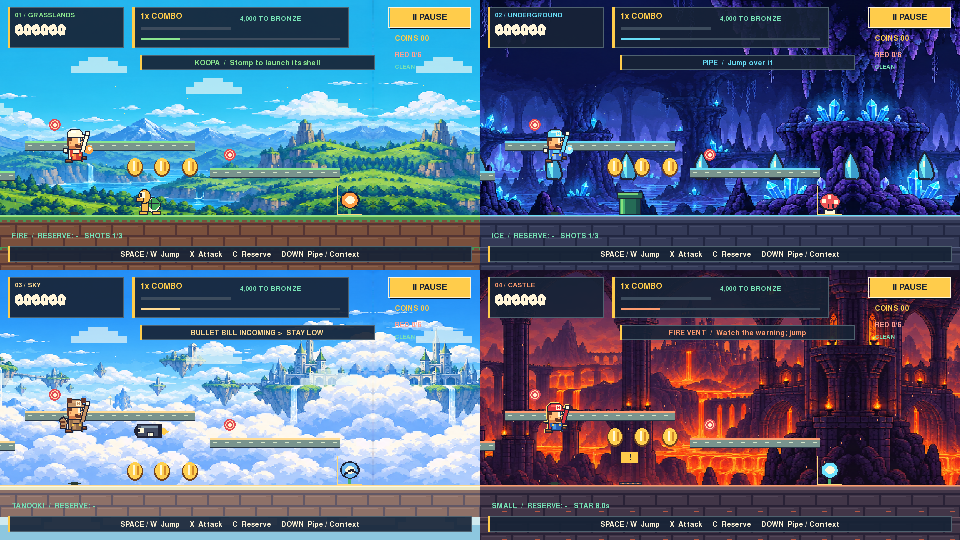
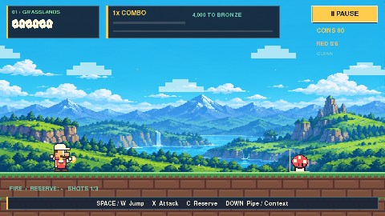

# Mario Runner — One Adventure

A Python/pygame-ce platform runner with a continuous four-world campaign, ten transformations, skill scoring, checkpoints, and optional ModernGL lighting. Pixel art stays sharp, controls stay responsive, and the complete game also works with software rendering and without audio.





## Run

Use Python **3.12 or newer**. On macOS, unzip the release and open **Play.command**. The launcher creates an isolated environment and installs the pinned packages on first launch; that first installation needs internet access. If macOS prevents opening a downloaded script, run these commands in Terminal instead:

```bash
git clone https://github.com/ShayanR22/Mario-Runner.git mario-runner
cd mario-runner
python3 -m venv .venv
source .venv/bin/activate
python -m pip install -r requirements.txt
python main.py
```

On Windows, activate with `.venv\Scripts\activate`. On Linux/macOS, use the activation command above. Force software rendering on machines without a suitable OpenGL context:

```bash
python main.py --renderer software
```

The only runtime dependencies are pinned pygame-ce, ModernGL, and glcontext. The optional screenshot tool uses Pillow for GIF export; Pillow is not needed to play. Do not install the separate `pygame` distribution alongside pygame-ce.

## Play

Choose **New Game**, or **Continue** for the current campaign. A new adventure starts in Grasslands and advances through Underground, Sky, and Castle. There is no campaign world-select menu. Starting over asks before replacing the current checkpoint; records and cosmetics remain.

Each course has a safe introduction, a midpoint checkpoint, a checkpoint before its final encounter, and a safe flagpole approach. Jump onto the pole for a height bonus. Mario slides down, hops off, and walks into the exit. Results automatically advance after six seconds; Castle ends with the campaign rank. Rewards are finalized when the pole is reached, before animation, so skipping or closing during the celebration cannot award them again.

### Default controls

| Action | Keyboard | Mouse |
| --- | --- | --- |
| Jump / double jump | Space, W, Up | Left click in the playfield |
| Shorter jump / stop floating | Release jump | Release left button |
| Attack / kick nearby frozen block | X | Right click |
| Swap equipped and reserve transformation | C | Mouse wheel |
| Pipe, Cat climb, Cape dive, Penguin slide | Down | Middle click |
| Pause / resume | P, Escape | Pause button |
| Skip celebration | Space, Enter | Skip button |
| Mute both audio channels | M | Settings |
| Fullscreen | F11 | — |
| Retry checkpoint | R from pause/game over | Retry button |
| Navigate menus | Arrows, Tab, Enter | Hover and click |

The third Settings page remaps the primary jump, attack, context, and reserve keys. W and Up remain jump alternatives. P, Escape, M, and F11 remain global controls. Focus loss pauses gameplay, celebrations, and timed results.

### Transformations

One transformation is equipped and one is held in reserve. Picking up a different form equips it and puts the previous form in reserve. Taking damage removes the equipped form and grants a short grace period. The reserve is kept. A duplicate pickup refreshes the current form without adding an extra reserve.

| Form | Behavior |
| --- | --- |
| Super Mushroom | Taller visual form, absorbs one hit |
| Fire Flower | Bouncing fireballs; three active maximum; short cooldown |
| Ice Flower | Freezes eligible enemies for four seconds; shoot again to shatter, or approach and attack/context to kick the block |
| Super Bell / Cat | Claw attack; attack in the air to dive; context near the green marked wall starts a one-second climb, then exits automatically |
| Super Star | Eight-second invincibility overlay, countdown, expiry warning, and 0.65-second grace |
| Tanooki | Tail spin; hold jump while descending to slow fall; double jumping remains available |
| Boomerang | One returning projectile; hits each enemy once and collects coins along its path |
| Cape | Slower sustained glide than Tanooki; context commits to a fast dive; tail attack |
| Penguin | Ice projectiles and a contextual shell-like belly slide in Underground's marked ice section; avoids the small landing skid |
| Mega Mushroom | Six-second overlay, enlarged art, and contact breaking of enemies and ordinary pipe obstacles |

Star and Mega run independent timers over the equipped form; they do not replace the reserve. Neither can destroy required platforms, checkpoints, bonus-room entrances, flagpoles, or exits. Forms preserve the same 32×60 collision body and foot anchor. This is a deliberate safety choice: Mushroom visually grows and Mega expands its attack reach without causing ceiling or route traps.

A form's visual cues, projectiles, warnings, and collision behavior work in both renderers. Ice blocks are safe to pass through rather than solid obstructions; kicking or shattering them remains optional. Dry Bones collapse/rebuild and thawing cannot create a permanent route barrier.

See [the full interaction table](docs/INTERACTIONS.md).

## Score and replay

Distance gives **no points**. Coins award 100, stomps 250, and shell defeats 500 base points. Other ability defeats award 250. Every five distinct scoring actions raises the multiplier, up to ×5. The triggering action uses the previous multiplier; the next action uses the raised multiplier. A 50-point fixed variety bonus rewards changing scoring styles. Damage resets the combo.

The 4.5-second combo clock only drains near reachable coins or enemies. It stops in safe gaps, pause screens, room transitions, bonus rooms, and celebrations. Floating labels show the exact award. Repeatedly collapsing Dry Bones, refreezing an enemy, or hitting the same target with a returning projectile cannot farm rewards.

Each world has six marked red coins on optional elevated routes. Their full set gives 2,400 fixed points. World clear gives 1,000; clearing without damage or retries gives another 1,000; flag height gives 500–3,000. These bonuses and aerial-chain bonuses are **not multiplied**. Stable reward IDs prevent duplicate awards. Retries roll back score, IDs, combo, enemies, ability/reserve, temporary timers, challenges, and collected sets to the same checkpoint snapshot.

Medal thresholds are **Bronze 4,000 / Silver 8,000 / Gold 13,000**. The HUD shows the next target. World results compare personal bests; Records shows the four world records and the best accumulated score. The final campaign rank gives another target: Explorer, Adventurer (16,000), Expert (32,000), or Superstar (52,000).

Silver and Gold unlock palettes; challenges unlock a trail; campaign completion unlocks celebration confetti. Cosmetics have no collision or strength advantage. Preview and equip them from Records → Cosmetics.

- **Alternate routes:** one-way platforms, with gently moving platforms in Sky. Ground remains traversable without abilities. Jump or double-jump onto the elevated route; Cat climbing and gliding offer additional ways to reach it.
- **Secret pipes:** context near the marked pipe at the safe clearing opens a short bonus room. The main course and its timers freeze, then resume at the same safe position. Room rewards belong to that run's checkpoint history.
- **Challenges:** no damage/retries, limited ability use, a full red set, and a top flag grab. They are optional.
- **Ghost:** a translucent replay of a completed, compatible personal best. Samples record position, form, animation pose, and jump state. The ghost has no collision or scoring effects. Only complete runs from the world start create a replacement ghost; checkpoint-resumed runs can set records but do not replace it with a partial recording. A missing, old, or corrupt replay is ignored.
- **Practice:** Records → Practice exposes only sections already encountered. Quick starts and checkpoint retries are available immediately. Practice has separate in-memory points and never changes the campaign, records, unlocks, or ghost files.

## Settings and rendering

Separate SFX/music volume, persistent mute, reduced motion, Enhanced/Standard effects, bloom strength, heat distortion, atmospheric particles, ghost visibility, optional camera shake, and remapping are saved locally. Music is a quiet original synthesized loop.

The renderer uploads separate world, interface, and protection layers. Bloom uses two reused 240×135 targets. At most eight local lights are active. Heat moves only unprotected castle scenery; actors, pickups, projectiles, platforms, the ground, and exits remain aligned. GPU failure falls back to software without changing physics or score. Iris reveals are rendered in the interface so software mode keeps the same transitions.

Reduced motion freezes decorative movement, removes camera impulses, shortens flag celebrations, and disables heat animation and transitions. A slow quality controller reduces optional atmospheric density after sustained expensive frames and recovers slowly; it never changes simulation rules.

## Architecture

| Module | Responsibility |
| --- | --- |
| `model.py` | Fixed-step world orchestration, contacts, snapshots, safe checkpoint normalization |
| `abilities.py`, `interactions.py`, `projectiles.py` | Data-driven transformations, explicit enemy responses, bounded projectiles |
| `levels.py`, `routes.py`, `secrets.py` | Deterministic encounters, swept platform landing/carrying, isolated bonus rooms |
| `scoring.py`, `balance.py`, `victory.py` | Unique rewards, configurable balance/medals, flag state machine |
| `storage.py`, `replays.py` | Atomic validated saves, scoring migration, compatible ghost recordings |
| `animation.py`, `pixelart.py`, `form_art.py`, `assets.py` | Animation selection, editable art, exported sheets, cached assets/masks |
| `scene.py`, `effects.py`, `rendering.py`, `shaders/` | World drawing, bounded decorative effects, protected GPU compositing/fallback |
| `app.py`, `ui.py`, `audio.py` | Application/input states, UI, synthesized sounds/music |

Simulation runs at 120 Hz independently of the 60 FPS display target. A frame's elapsed contribution is capped at 0.1 seconds after long stalls. Input buffering and coyote time are 0.12 and 0.09 seconds. Collision bodies do not depend on an animation pose.

### Saves

Save format 4 separates permanent records, cosmetics, encountered practice sections, current campaign checkpoint, and completion tokens. Writes use a temporary file, flush/fsync, then atomic replacement. Failed writes retain in-memory progress and show a notice.

On macOS: `~/Library/Application Support/MarioRunner/save.json`. Windows uses `%LOCALAPPDATA%/MarioRunner`, Linux uses `$XDG_DATA_HOME/MarioRunner` or `~/.local/share/MarioRunner`. `MARIO_RUNNER_SAVE` overrides the location for tests.

Old scoring is preserved under **Legacy records**. Old checkpoints lack the expanded snapshot, so migration starts their current world from its beginning with the new scoring rules. Compatible volume, graphics, completed worlds, and settings survive. Safe checkpoints normalize Mario to the ground and clear transient projectiles before storing the complete remaining encounter state. Closing mid-section resumes the last checkpoint, rolling back that section's rewards as well as its hazards.

## Validation and developer tools

```bash
python -m unittest discover -s tests -v
python tools/validate_campaign.py
python tools/check_graphics.py       # native display/OpenGL required
python tools/build_art.py            # deterministic art export; no network calls
python tools/capture_screenshots.py   # isolated save; optional Pillow for GIF
python tools/package_release.py
```

See [validation results](docs/VALIDATION.md), [course measurements](docs/course-check.json), [GPU measurements](docs/graphics-check.json), and [implementation checklist](docs/UPGRADE_CHECKLIST.md). Reports describe the tested machine and test policies, not universal performance guarantees.

## Credits and scope

Artwork is a combination of the project's existing generated biome atlas and editable programmatic sprites. This upgrade extends that sprite system rather than generating mismatched replacement art. Sounds/music are synthesized in code. SuperMario256 was supplied by the user; its license was not supplied. See [asset provenance](docs/ASSETS.md) and the preserved [historical art prompts](docs/ART_PROMPTS.md).

This is an unofficial Mario fan project. No Nintendo trademark, character, or font rights are claimed. For a publicly licensed original-game release, replace the character/theme and any assets whose redistribution license is unknown.

The deliberately compact campaign uses encounter finales rather than a Bowser boss. Cat climbing is limited to marked optional walls, Penguin traction is a small skid/slide interaction in one ice section, and all forms use stable collision geometry. Subjective difficulty, audio taste, and long-session balance still benefit from human playtesting. No browser port, online leaderboard, controller support, or executable bundler is included.
